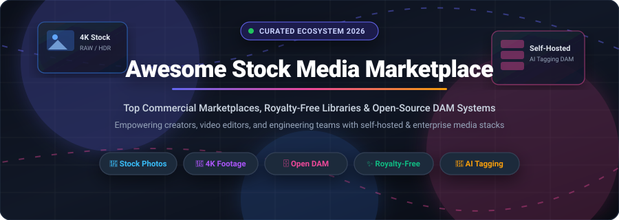

<div align="center">



# 📸 Awesome Stock Media Marketplace & DAM Ecosystem 🎥

<p align="center">
  <a href="https://github.com/ishandutta2007/Awesome-Awesome-Awesome"></a><a href="https://discord.gg/jc4xtF58Ve"></a>
  <a href="LICENSE"></a>
  <a href="https://github.com/ishandutta2007/Awesome-Stock-Media-Marketplace/pulls"></a>
  <a href="https://github.com/ishandutta2007/Awesome-Stock-Media-Marketplace/stargazers"></a>
  <a href="https://github.com/ishandutta2007"></a>
</p>

**A curated, production-ready directory of SaaS stock media platforms, commercial licensing marketplaces, and self-hosted open-source Digital Asset Management (DAM) systems.**

*Explore royalty-free photography, 4K/8K video footage, vector graphics, audio libraries, and self-hosted AI-driven asset repositories.*

</div>

---

## 📑 Table of Contents

- [🌐 Sector Overview & Market Dynamics](#-sector-overview--market-dynamics)
- [🏢 SaaS & Commercial Marketplaces](#-saas--commercial-marketplaces)
- [💻 Open-Source GitHub Projects](#-open-source-github-projects)
- [⚖️ Architecture & Deployment Guide: SaaS vs. Self-Hosted DAM](#️-architecture--deployment-guide-saas-vs-self-hosted-dam)
- [🤝 How to Contribute](#-how-to-contribute)
- [⭐ Star History](#-star-history)
- [💖 Support & Community](#-support--community)
- [📜 Disclaimer & License](#-disclaimer--license)

---

## 🌐 Sector Overview & Market Dynamics

The global stock media and digital asset management (DAM) market is estimated at **$5.8 billion in 2024** and is projected to reach **$10.5 billion by 2030**, advancing at a compound annual growth rate (CAGR) of **~10.2%**, driven by surging demand for high-resolution video streaming, generative AI media generation, e-commerce catalog scaling, and enterprise creative workflows.

From a market structure perspective, the industry is **moderately concentrated at the enterprise commercial tier**—where a dominant oligopoly consisting of Adobe Stock, Getty Images (including iStock and Unsplash), and Shutterstock commands over 65% of paid enterprise licensing revenue through deep workflow lock-in and legal indemnity guarantees. Concurrently, the industry remains **highly fragmented across the creator, freemium, and self-hosted tiers**, where freemium hubs (Freepik, Pexels, Pixabay) and vibrant open-source self-hosted solutions (such as Immich, PhotoPrism, and UnoPim DAM) prevent a winner-take-all monopoly by giving developers and privacy-conscious organizations sovereign control over their media assets.

---

## 🏢 SaaS & Commercial Marketplaces

The following table compares leading hosted stock media marketplaces and enterprise asset platforms. Sorted in **descending order by company scale (annual revenue / enterprise valuation)**.

| 🏷️ Platform | 🏢 Company Scale (Revenue / Valuation) | 💳 Starting Tier Pricing | 🎁 Free Tier / Free Trial Limits | 🔍 Core Capabilities & Asset Library |
| :--- | :--- | :--- | :--- | :--- |
| **[Adobe Stock](https://stock.adobe.com)** | **~$21.5B Annual Revenue**<br>(Adobe Inc. / Market Cap ~$180B) | **$29.99/mo** (annual plan) for 10 standard assets/mo ($2.99/asset); or **$49.99/mo** month-to-month; Credit packs start at **$49.95** for 5 credits | **30-Day Free Trial** granting 10 free standard asset downloads (cancelable without fee before trial ends); permanent access to **1,000,000+ free curated photos and vectors** with standard commercial license | Native deep integration into Adobe Creative Cloud (Photoshop, Illustrator, Premiere Pro); 300M+ photos, 4K footage, vectors, audio, and 3D assets with full enterprise copyright indemnification. |
| **[Canva / Pexels & Pixabay](https://www.canva.com)** | **~$2.5B Annual Revenue**<br>(Canva / Valuation ~$26B) | **$12.99/mo** (or **$119.99/yr**) for Canva Pro per user; Pexels and Pixabay core repositories remain 100% free | **Free Forever Plan**: Unlimited downloads across 4.5M+ photos and videos under custom Pexels/Pixabay free commercial licenses; REST API free tier offers **20,000 requests/month** (200 requests/hour) | Combined powerhouse spanning drag-and-drop graphic design with direct access to over 100M+ stock images, video clips, music tracks, and illustrations; attribution-free commercial licensing. |
| **[Getty Images / iStock / Unsplash](https://www.gettyimages.com)** | **~$920M Annual Revenue**<br>(Getty Images Holdings / Market Cap ~$1.5B) | **$4.00/mo** ($48 billed annually) or **$12.00/mo** for Unsplash+; **$29.00/mo** for iStock Essential (10 downloads); Getty Images individual high-res downloads start at **$175.00** | **Free Forever Plan** (Unsplash): Unlimited downloads across 5M+ high-resolution stock photos for personal and commercial usage (no attribution required); iStock provides a **30-Day Free Trial** with 10 image downloads | Industry benchmark for editorial, archival, and premium commercial photography; exclusive news and sports photojournalism archive with up to $250,000+ legal indemnity guarantees. |
| **[Shutterstock / Pond5 / Envato](https://www.shutterstock.com)** | **~$875M Annual Revenue**<br>(Shutterstock Inc. / Market Cap ~$800M) | **$29.00/mo** (annual commitment) for 10 image downloads/mo ($2.90/asset) or **$49.00/mo** month-to-month; On-demand image packs start at **$49.00** for 5 images | **30-Day Free Trial** offering 10 free image downloads upon registration (cancelable within 30 days); Free registered accounts receive **1 free photo and 1 free vector download every week** | Catalog exceeding 450M+ photos, 4K/8K video clips, audio tracks, and 3D models; includes Pond5's video library and Envato Elements' unlimited creative asset ecosystem. |
| **[Freepik](https://www.freepik.com)** | **~$100M Annual Revenue**<br>(Freepik Company / Valuation ~$700M) | **€9.00/mo** (~$10.00/mo, billed annually at €108/yr) or **€15.00/mo** (~$16.50/mo month-to-month) for 100 daily downloads | **Free Forever Plan**: 10 downloads per calendar day for registered users (3 downloads/day for non-registered users); all free downloads require mandatory author attribution | Huge repository of over 150M+ graphic assets, vectors, PSD mockups, stock photos, presentation templates, and integrated AI image generation tools. |
| **[Storyblocks](https://www.storyblocks.com)** | **~$55M Annual Revenue**<br>(Storyblocks / Valuation ~$200M) | **$15.00/mo** (billed annually at $180/yr) for Starter tier (5 downloads/mo); **$30.00/mo** (billed annually at $360/yr) for Unlimited All-Access tier | **7-Day Free Trial** promotion with 5 free high-definition downloads (promotional periods, requires registration); free unlimited watermarked preview downloads for rough-cut editing | Subscription-first marketplace engineered for video creators, editors, and broadcast agencies with unlimited download options across 4K footage, After Effects templates, and audio. |

---

## 💻 Open-Source GitHub Projects

Explore top-tier open-source self-hosted Digital Asset Management (DAM) platforms, photo catalog engines, media repositories, and stock dataset projects. **Sorted in descending order by GitHub star count**.

### 1. [Immich](https://github.com/immich-app/immich) [](https://github.com/immich-app/immich/stargazers)
- **Primary Stack**: TypeScript, Dart (Flutter), Python, PostgreSQL, Redis
- **Highlights**: High-performance, self-hosted photo and video management solution designed as a direct self-hosted replacement for Google Photos and cloud media hubs. Offers facial recognition, object detection, reverse geocoding, multi-user support with partner sharing, automatic background mobile uploads, and hardware-accelerated video transcoding.
- **Best For**: Creators, photographers, and teams needing a robust self-hosted media backup and viewing infrastructure.

### 2. [PhotoPrism](https://github.com/photoprism/photoprism) [](https://github.com/photoprism/photoprism/stargazers)
- **Primary Stack**: Go, Vue.js, TensorFlow, SQLite / MariaDB
- **Highlights**: AI-powered photo management app for the decentralized web. Features automated image classification based on Google TensorFlow, face cluster recognition, semantic search by colors, dates, and locations, sidecar metadata sync, and RAW camera file conversion via darktable and RawTherapee.
- **Best For**: Advanced photographers and digital archivists looking for automated AI categorization without vendor cloud lock-in.

### 3. [Awesome Stock Resources](https://github.com/neutraltone/awesome-stock-resources) [](https://github.com/neutraltone/awesome-stock-resources/stargazers)
- **Primary Stack**: Markdown / Curated Community Directory
- **Highlights**: Extensive, crowd-sourced compendium of free stock photography, royalty-free footage, vector icons, audio samples, and typography libraries across the open web.
- **Best For**: UI/UX designers, video editors, and indie makers seeking verified free media repositories.

### 4. [UnoPim DAM](https://github.com/unopim/unopim) [](https://github.com/unopim/unopim/stargazers)
- **Primary Stack**: PHP (Laravel), Vue.js, MySQL
- **Highlights**: Open-source Product Information Management (PIM) and Digital Asset Management (DAM) system engineered to manage and enrich millions of digital assets and catalog items. Includes folder trees, batch metadata tagging, expiring shared links, embedded image editing, and Magic AI auto-tagging.
- **Best For**: E-commerce companies, brands, and agencies that require unified product data and asset management.

### 5. [LibrePhotos](https://github.com/LibrePhotos/librephotos) [](https://github.com/LibrePhotos/librephotos/stargazers)
- **Primary Stack**: Python (Django), TypeScript (React), PostgreSQL
- **Highlights**: Self-hosted, privacy-first photo management service. Provides automated face recognition using deep learning, semantic search ("photos of dogs on a beach"), GPS map views, support for video and RAW formats, and multi-user privacy partitions.
- **Best For**: Privacy enthusiasts wanting full ownership of their photo libraries with intelligent search.

### 6. [Piwigo](https://github.com/Piwigo/Piwigo) [](https://github.com/Piwigo/Piwigo/stargazers)
- **Primary Stack**: PHP, MySQL
- **Highlights**: Established web gallery and asset manager with more than 200 extensions and themes. Supports extensive user permissions, hierarchical albums, batch manager, EXIF/IPTC metadata indexing, and high-volume media collections.
- **Best For**: Heritage institutions, schools, clubs, and photo studios needing an extensible web gallery.

### 7. [Unsplash Datasets](https://github.com/unsplash/datasets) [](https://github.com/unsplash/datasets/stargazers)
- **Primary Stack**: TSV, Parquet, Python
- **Highlights**: Public dataset of over 7.4 million high-quality stock images made available by Unsplash for research, machine learning benchmark evaluation, computer vision, and multimodal AI training.
- **Best For**: AI researchers, data scientists, and ML engineers building visual discovery and classification models.

### 8. [Chevereto-Free](https://github.com/rodber/chevereto-free) [](https://github.com/rodber/chevereto-free/stargazers)
- **Primary Stack**: PHP, JavaScript, MariaDB
- **Highlights**: Self-hosted image hosting software enabling users and communities to operate their own alternative to Imgur or Flickr. Offers drag-and-drop upload, album sharing, user accounts, and direct image embed codes for forums and blogs.
- **Best For**: Community platforms, forums, and creators desiring a self-managed public or private image hosting portal.

### 9. [Afilmory](https://github.com/Afilmory/afilmory) [](https://github.com/Afilmory/afilmory/stargazers)
- **Primary Stack**: TypeScript, React, Next.js, WebGL
- **Highlights**: Modern, aesthetic photo gallery tailored specifically for professional photographers. Features S3 and GitHub synchronization, comprehensive EXIF camera extraction, interactive geographic maps, and hardware-accelerated WebGL viewing.
- **Best For**: Photographers wanting a minimalist, portfolio-grade showcase with automated object storage sync.

### 10. [Pigallery2](https://github.com/bpatrik/pigallery2) [](https://github.com/bpatrik/pigallery2/stargazers)
- **Primary Stack**: TypeScript, Node.js, Angular, SQLite
- **Highlights**: Lightweight directory-first photo gallery web application optimized for low-resource environments such as Raspberry Pi servers. Reads existing directory structures on disk without altering folders, providing on-the-fly thumbnail generation.
- **Best For**: Homelab users and Raspberry Pi owners desiring zero-reorganization photo browsing.

### 11. [Damselfly](https://github.com/Webreaper/Damselfly) [](https://github.com/Webreaper/Damselfly/stargazers)
- **Primary Stack**: C# (.NET), Blazor, SQLite
- **Highlights**: Server-hosted photograph management system built to index hundreds of thousands of images. Features AI face detection, IPTC keyword metadata writing directly into files, full-text EXIF search, and lightweight Docker container deployment.
- **Best For**: Families and freelance photographers wanting fast facial recognition on home NAS or server setups.

### 12. [Serpent](https://github.com/dolag233/Serpent) [](https://github.com/dolag233/Serpent/stargazers)
- **Primary Stack**: TypeScript, Electron, Vue.js
- **Highlights**: Cross-platform desktop digital asset management software tailored for game developers, VFX artists, and 3D animators. Manages textures, 3D meshes, audio clips, and reference imagery with visual tags and rapid preview pipelines.
- **Best For**: Game designers, CGI artists, and motion graphics animators managing heavy multimedia assets.

### 13. [Phraseanet](https://github.com/alchemy-fr/Phraseanet) [](https://github.com/alchemy-fr/Phraseanet/stargazers)
- **Primary Stack**: PHP, Docker, Elasticsearch, MariaDB
- **Highlights**: Enterprise-grade open-source DAM system by Alchemy. Features modular microservices (Databox for DAM, Expose for static asset export, Uploader for ingestion), advanced faceted Elasticsearch querying, and support for high-throughput publishing.
- **Best For**: Media enterprises, government agencies, and universities handling millions of production assets.

### 14. [FreeFrame](https://github.com/Techiebutler/freeframe) [](https://github.com/Techiebutler/freeframe/stargazers)
- **Primary Stack**: TypeScript, Next.js, Python (FastAPI), FFmpeg
- **Highlights**: Open-source self-hosted alternative to Frame.io designed for video review, timecoded annotations, and collaborative multimedia post-production asset pipelines.
- **Best For**: Video editing studios, post-production teams, and freelance videographers wanting self-hosted review workflows.

### 15. [AWS VAMS](https://github.com/awslabs/visual-asset-management-system) [](https://github.com/awslabs/visual-asset-management-system/stargazers)
- **Primary Stack**: Python, AWS CDK, TypeScript, OpenSearch
- **Highlights**: Visual Asset Management System (VAMS) from AWS Labs. Purpose-built cloud-native architecture for managing, converting, and distributing 2D, 3D, and spatial visual assets used in spatial computing and physical AI.
- **Best For**: Cloud architects, spatial computing creators, and enterprise teams deploying scalable DAM on AWS infrastructure.

### 16. [AtroDAM](https://github.com/atrocore/atrodam) [](https://github.com/atrocore/atrodam/stargazers)
- **Primary Stack**: PHP (AtroCore), Backbone.js, MariaDB
- **Highlights**: Service-oriented, open-source DAM built on the AtroCore framework. Features customizable data modeling, RESTful API endpoints, automated asset transformations, and fine-grained role-based permission controls.
- **Best For**: Enterprise organizations requiring bespoke data schemas and automated multi-channel asset publishing.

### 17. [ResourceSpace](https://github.com/resourcespace/resourcespace) [](https://github.com/resourcespace/resourcespace/stargazers)
- **Primary Stack**: PHP, MariaDB, FFmpeg, ImageMagick, ExifTool
- **Highlights**: Highly established, battle-tested open-source DAM used widely across cultural institutions and non-profits. Features automated transcoding, extensive metadata schema configuration, batch ingestion, and enterprise audit trails.
- **Best For**: Non-profit organizations, museums, and educational institutions looking for a mature LAMP-stack DAM.

### 18. [Starsky](https://github.com/qdraw/starsky) [](https://github.com/qdraw/starsky/stargazers)
- **Primary Stack**: C# (.NET Core), TypeScript (React), Docker
- **Highlights**: Photo management engine and search accelerator driven by EXIF metadata. Enables users to organize and search personal image libraries stored on private servers.
- **Best For**: Developers seeking a lightweight .NET-based photo cataloging service.

### 19. [Longpoint](https://github.com/longpoint-io/longpoint) [](https://github.com/longpoint-io/longpoint/stargazers)
- **Primary Stack**: TypeScript, Node.js, AI Model Connectors
- **Highlights**: Modern, extensible AI-native digital asset management framework. Built for semantic search using natural language embeddings, automated classification, and modular cloud storage backends.
- **Best For**: Engineering teams building next-generation AI-assisted media catalog applications.

### 20. [ShutterSea](https://github.com/saleel/shuttersea) [](https://github.com/saleel/shuttersea/stargazers)
- **Primary Stack**: JavaScript, IPFS, Textile ThreadDB, Ceramic IDX
- **Highlights**: Experimental decentralized stock photography platform where photographers share imagery without intermediary control. Assets are pinned to IPFS with cryptographic identity verification.
- **Best For**: Web3 developers exploring decentralized file distribution and censorship-resistant media sharing.

---

## ⚖️ Architecture & Deployment Guide: SaaS vs. Self-Hosted DAM

```
┌────────────────────────────────────────────────────────────────────────┐
│                   DECISION MATRIX: STOCK MEDIA & DAM                   │
├───────────────────────────────────┬────────────────────────────────────┤
│      SaaS Marketplace / Cloud     │    Self-Hosted Open-Source DAM     │
│   (Adobe Stock, Getty, Canva)     │     (Immich, PhotoPrism, UnoPim)   │
├───────────────────────────────────┼────────────────────────────────────┤
│ • Zero infrastructure management  │ • 100% data sovereignty & privacy  │
│ • Millions of ready-to-use assets │ • Unlimited storage (own S3/NAS)   │
│ • Legal copyright indemnification │ • Zero per-seat recurring fees     │
│ • Automatic CDN global delivery   │ • Customizable AI inference pipelines│
│ • Higher recurring expense        │ • Requires devops & backup hygiene │
└───────────────────────────────────┴────────────────────────────────────┘
```

### Key Considerations

1. **Licensing & Legal Indemnity**: If your enterprise produces global television advertisements, billboard campaigns, or high-risk commercial branding, SaaS providers like **Adobe Stock** and **Getty Images** offer commercial indemnification ($10,000 to $250,000+ protection against copyright claims).
2. **Storage Costs & Data Gravity**: If your production generates terabytes of raw 4K/8K footage, SaaS storage tiers become cost-prohibitive. Self-hosting tools like **Immich**, **Phraseanet**, or **UnoPim** on local ZFS arrays or Wasabi/MinIO S3 storage can reduce ongoing expenses by over 80%.
3. **AI Metadata & Tagging**: Open-source solutions such as **PhotoPrism** and **Damselfly** offer local face clustering and classification models without sending private enterprise media to third-party APIs.

---

## 🤝 How to Contribute

We welcome community contributions, new platform listings, and updates!

1. 🍴 **Fork this repository**.
2. 🌿 **Create a new branch**: `git checkout -b feature/add-new-dam-platform`.
3. 📝 **Add or update entries** following existing markdown table and section standards:
   - Provide verified GitHub stargazers link and badge.
   - For SaaS tools, detail specific starting pricing and free tier/trial boundaries.
4. 🚀 **Commit your changes**: `git commit -m "feat: add NewMediaPlatform"`.
5. 📤 **Push to your branch**: `git push origin feature/add-new-dam-platform`.
6. 🎯 **Open a Pull Request** with a concise summary of the addition.

---

## ⭐ Star History

[](https://star-history.dera.page/#ishandutta2007/Awesome-Stock-Media-Marketplace&type=date&legend=top-left)

---

## 💖 Support & Community

Thank you for exploring and bookmarking **Awesome Stock Media Marketplace**! If this curated ecosystem helps streamline your media discovery, digital asset pipelines, or infrastructure architecture:

- ⭐ **Star this repository** to elevate its visibility across GitHub.
- 🍴 **Fork and share** with colleagues, creative studios, and open-source developers.
- ☕ **Sponsor & Buy a Coffee**: Support continuous open-source maintenance, curation, and updates directly through the [GitHub Sponsors Dashboard](https://github.com/sponsors/ishandutta2007).

---

## 📜 Disclaimer & License

- **Disclaimer**: This directory is community-curated for informational and architectural guidance. Product names, logos, and brands are property of their respective owners. Mention does not constitute commercial endorsement. Verify up-to-date commercial licensing terms and indemnity policies prior to enterprise deployment.
- **License**: Released under the [MIT License](LICENSE).

---

<div align="center">
  <sub>Maintained with ❤️ by <a href="https://github.com/ishandutta2007">Ishan Dutta</a> and the global open-source community.</sub>
</div>
